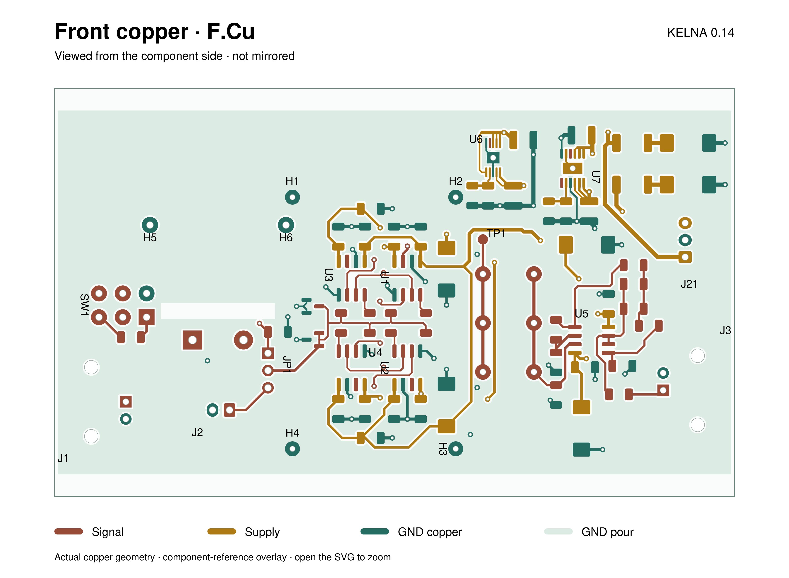
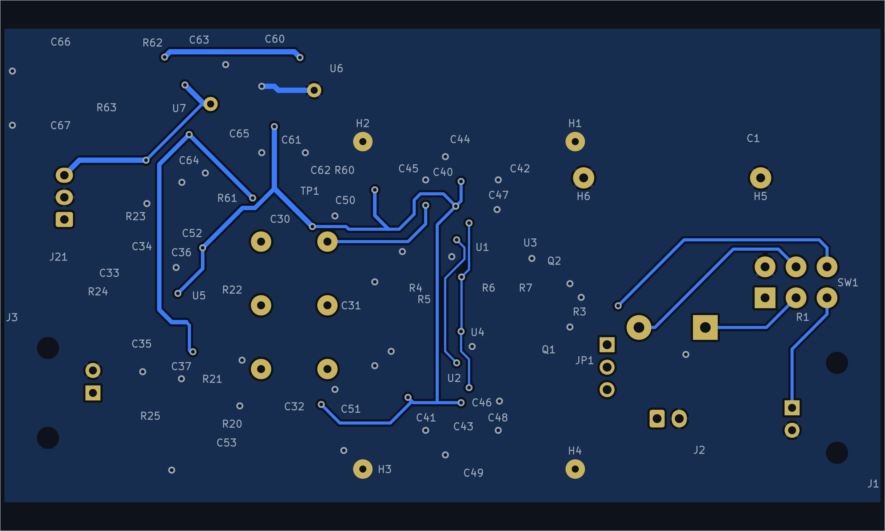
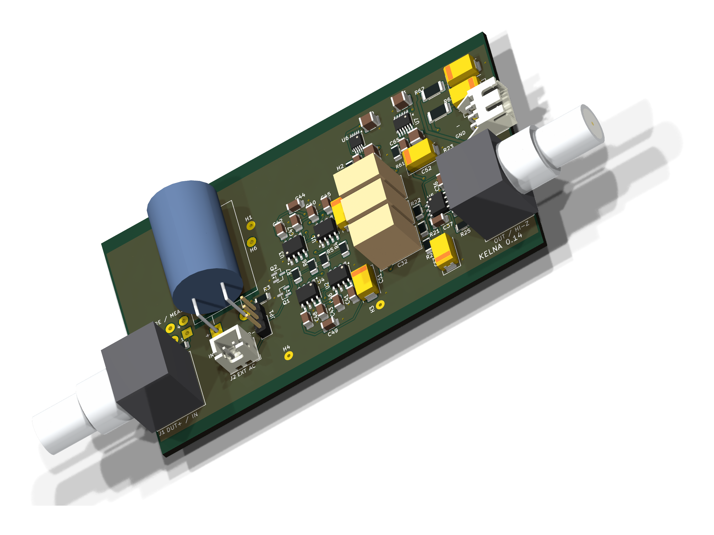
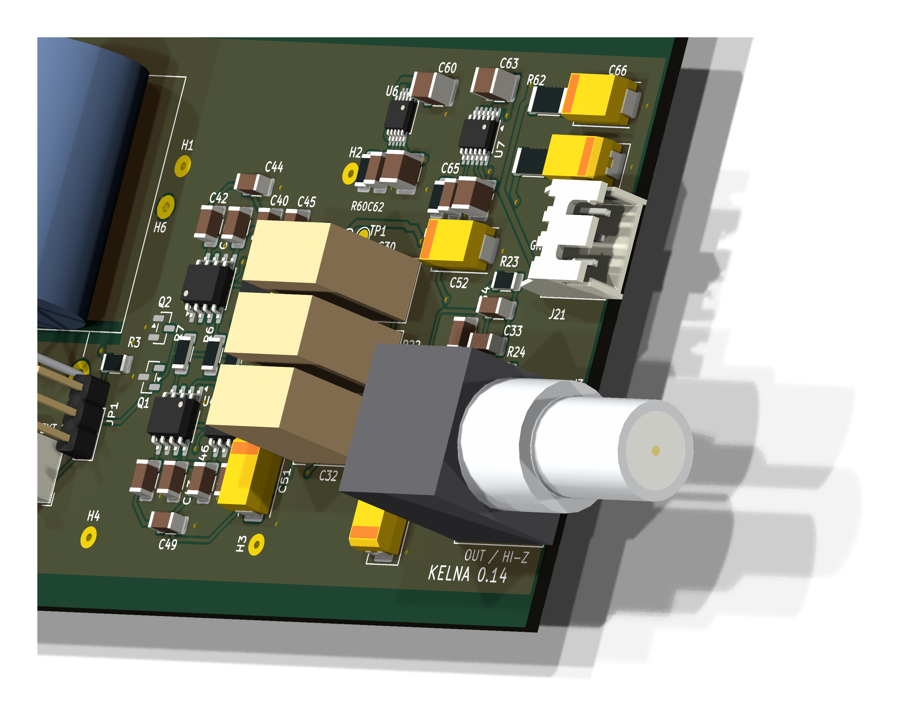

# KELNA

> [!NOTE]
> **This project is under development.**

Low-frequency noise preamplifier hardware for precision voltage references and Zener diodes, designed for the **0.1–10 Hz** measurement window. Nominal midband gain is **11,400 V/V (≈81.1 dB)**. The prototype uses a split battery supply of **±6.8 to ±8.4 V** and a **high-impedance output load**.

## PCB routing

**Front copper** · [SVG](docs/images/copper-front.svg)

**Back copper** · Underside view with reference overlay · [SVG](docs/images/copper-back.svg)

## Using the input

For the BNC input (J1), set JP1 to **1–2 (INT)**. Select **PRE** before connecting a reference, with positive voltage on the centre pin and return on the shell.

| SW1 position | Signal path |
| --- | --- |
| **PRE — precharge** | Charges C1 (2,200 µF) through R1 (15 kΩ) while isolating the amplifier from the reference's DC step. |
| **MEAS — measure** | Bypasses R1 and AC-couples the reference noise to the amplifier through C1. R3 (10 kΩ) provides the bias return. |

With a low-impedance 7 V reference and a discharged C1, PRE initially draws **0.47 mA**. The nominal time constant is **33 s**. Ideally, C1 charges to within **0.5 mV** of the reference in about **5.3 min**. After switching to MEAS, check that the first stage has headroom at TP1 and that J3 has settled before recording. Return to PRE before changing the reference or powering down.

For an external selector, move the single JP1 shunt to **2–3 (EXT)** and feed J2. This path bypasses C1, SW1 and R3. The selector must provide its own AC coupling, input bias return and precharge.

## Two gain stages

1. **×2,000** — four AD8428 amplifiers in parallel, with the output taken from U1 and AC-coupled to the second stage. [Analog Devices circuit, Figure 1](https://www.analog.com/en/resources/analog-dialogue/articles/low-noise-inamp-nanovolt-sensitivity.html)
2. **×5.7** — OPA2140 non-inverting gain stage (1 kΩ and 4.7 kΩ), followed by a second-order **10 Hz** low-pass filter.

The nominal midband gain is **2,000 × 5.7 = 11,400 V/V**. The two AC couplings have nominal corners near 7 mHz with a low-impedance source on J1. Apply the 0.1 Hz lower limit when analysing the recording.

## Board and connectors

100 × 60 mm, two layers. Connect J3 to a high-impedance input. Power connector J21 uses **1 = +BAT, 2 = battery midpoint / GND, 3 = −BAT**.

## Design files

- [KiCad project](KELNA.kicad_pro), [schematic](KELNA.kicad_sch) and [PCB](KELNA.kicad_pcb)
- [Vector schematic PDF](docs/schematic.pdf)
- [Assembly and mechanical drawings](KELNA-placement.pdf)
- [Copper-layer PDF](KELNA-routing.pdf)
- [Bill of materials](KELNA-BOM.csv) and [DRC report](KELNA-DRC.rpt)
- [Revision 0.14 fabrication archive](fabrication/KELNA-rev0.14-fab.zip)

## Schematic

[Schematic SVG](docs/images/schematic.svg) · [Schematic PDF](docs/schematic.pdf)

Several local footprints use KiCad library land patterns with modified silkscreen or solder access. [KiCad library notice](third_party/KiCad-library-license.md).
