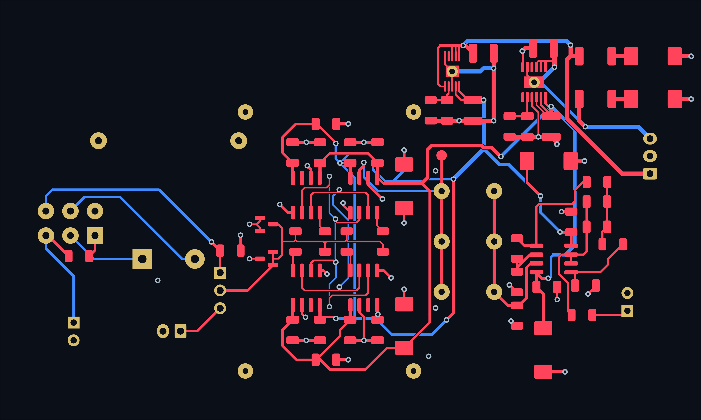

# KELNA

Low-frequency noise preamplifier hardware for precision voltage references and Zener diodes, designed for the **0.1–10 Hz** measurement window. Nominal midband gain is **11,400 V/V (≈81.1 dB)**. The prototype uses a split battery supply of **±6.8 to ±8.4 V** and a **high-impedance output load**.

## PCB routing

Both copper layers are shown below as seen from the component side. **Red tracks run on F.Cu, blue tracks run on B.Cu.** Copper pours are hidden in this view so that individual tracks and layer changes are visible. Click the image for the full-size drawing.

The individual layer views include the filled copper zones in a darker shade. Gold rings mark through-hole pads and grey rings mark vias. The underside view shows the board flipped left to right.

| Front copper · component side | Back copper · physical underside |
| --- | --- |
|  |  |

Vector drawings are available for [both layers](docs/images/routing-both.svg), [front copper](docs/images/copper-front.svg) and [back copper](docs/images/copper-back.svg).

## Using the input

For a single reference or Zener diode, fit the JP1 shunt across pins **1–2 (INT)**. Set SW1 to **PRE** before connecting the reference to the front-panel BNC (J1), with positive voltage on the centre pin and return on the shell.

| SW1 position | Signal path |
| --- | --- |
| **PRE — precharge** | The reference charges C1 (2,200 µF) through R1 (15 kΩ). SW1 grounds the other plate of C1 and disconnects it from the amplifier. This limits the charging current and keeps the DC step out of the gain stage. |
| **MEAS — measure** | SW1 bypasses R1 and connects the charged C1 to the amplifier. C1 blocks the reference's DC voltage while passing its fluctuations. R3 (10 kΩ) provides the input bias return. |

With a low-impedance 7 V reference and a discharged C1, PRE initially draws **0.47 mA**. The nominal time constant is **33 s**. Ideally, C1 charges to within **0.5 mV** of the reference in about **5.3 min**. After switching to MEAS, check that the first stage has headroom at TP1 and that J3 has settled before recording. Return to PRE before changing the reference or powering down.

For an external selector, move the single JP1 shunt to **2–3 (EXT)** and feed J2. This path bypasses C1, SW1 and R3. The selector must provide its own AC coupling, input bias return and precharge.

## Two gain stages

1. **Input stage · ×2,000.** Four AD8428 instrumentation amplifiers (U1–U4) share the same input. Their like-polarity FIL pins are tied together to average the front ends' uncorrelated voltage noise. U1 alone drives TP1. Three parallel 2.2 µF capacitors (C30–C32) and R20 (3.3 MΩ) AC-couple this output to the second stage, blocking first-stage DC offset. [Analog Devices circuit, Figure 1](https://www.analog.com/en/resources/analog-dialogue/articles/low-noise-inamp-nanovolt-sensitivity.html)
2. **Output stage · ×5.7.** U5A, one half of the OPA2140, provides a non-inverting gain of **1 + 4.7 kΩ / 1 kΩ = 5.7**. U5B implements a unity-gain, second-order **10 Hz** low-pass filter. R25 (2.2 kΩ) connects its output to the rear BNC (J3) for a high-impedance instrument.

The nominal midband gain is **2,000 × 5.7 = 11,400 V/V**. A 1 µV input fluctuation at 1 Hz therefore produces about 11.4 mV at J3. The input and interstage high-pass corners are about 7.2 mHz and 7.3 mHz, respectively, with J1 selected and a low-impedance source. Apply the 0.1 Hz lower limit when analysing a 0.1–10 Hz noise recording.

## Board and connectors

The two-layer PCB measures 100 × 60 mm. The LT3042 and LT3094 regulate the analog rails. The rear power connector J21 sits beside J3. Its pinout is **1 = +BAT, 2 = battery midpoint / GND, 3 = −BAT**.

## Design files

- [KiCad project](KELNA.kicad_pro), [schematic](KELNA.kicad_sch) and [PCB](KELNA.kicad_pcb)
- [Vector schematic PDF](docs/schematic.pdf)
- [Assembly and mechanical drawings](KELNA-placement.pdf)
- [Copper-layer PDF](KELNA-routing.pdf)
- [Bill of materials](KELNA-BOM.csv) and [DRC report](KELNA-DRC.rpt)
- [Revision 0.14 fabrication archive](fabrication/KELNA-rev0.14-fab.zip)

## Schematic

Open the [SVG](docs/images/schematic.svg) or [PDF](docs/schematic.pdf) to zoom into the complete sheet.

For assembly, follow the drawings for C1 insulation, its retaining wire and the shield-lid clearance. The 3D views illustrate the PCB and component models.

Several local footprints use KiCad library land patterns with modified silkscreen or solder access. [KiCad library notice](third_party/KiCad-library-license.md).
