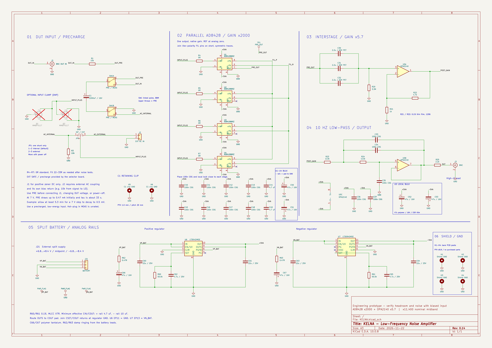

# KELNA

Low-frequency noise preamplifier hardware for precision voltage references and Zener diodes, designed for the **0.1–10 Hz** measurement window. Nominal midband gain is **11,400 V/V (≈81.1 dB)**. The prototype uses a split battery supply of **±6.8 to ±8.4 V** and a **high-impedance output load**.

Four AD8428 devices form the input stage; an OPA2140 provides the following gain and low-pass filter. LT3042 and LT3094 regulate the analog supplies. The two-layer PCB measures 100 × 60 mm.

The front panel carries **J1 input** and the **PRE / MEAS switch**. The right-hand rear panel carries **J3 output** and **J21 power**. J21 pin numbers: **1 = +BAT, 2 = midpoint / GND, 3 = −BAT**.

## Design files

- [KiCad project](KELNA.kicad_pro), [schematic](KELNA.kicad_sch) and [PCB](KELNA.kicad_pcb)
- [Vector schematic PDF](docs/schematic.pdf)
- [Assembly and mechanical drawings](KELNA-placement.pdf)
- [Copper-layer PDF](KELNA-routing.pdf)
- [Bill of materials](KELNA-BOM.csv) and [DRC report](KELNA-DRC.rpt)
- [Revision 0.14 fabrication archive](fabrication/KELNA-rev0.14-fab.zip)

## Copper layers

Click either image for the vector drawing. Reference labels are an overlay.

| F.Cu — viewed from the component side | B.Cu — viewed from the physical underside |
| --- | --- |
|  |  |

The underside image is **mirrored horizontally relative to the front image**.

## Schematic

Open the [SVG](docs/images/schematic.svg) or [PDF](docs/schematic.pdf) to zoom into the complete sheet.

For assembly, follow the drawings for C1 insulation, its retaining wire and the shield-lid clearance. The 3D views illustrate the PCB and component models.

Several local footprints use KiCad library land patterns with modified silkscreen or solder access. [KiCad library notice](third_party/KiCad-library-license.md).
